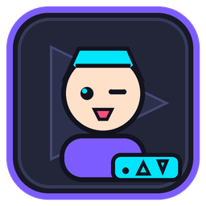
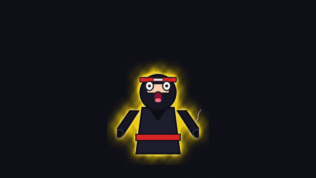

<p align="center">
  
</p>

<h1 align="center">AvatarScript</h1>

<p align="center">
  <strong>A deterministic animation engine & domain-specific language for 2D reaction avatars, VTubers, and commentary videos.</strong>
</p>

<p align="center">
  <a href="LICENSE"></a>
  <a href="https://www.python.org/"></a>
  <a href="vscode-avatarscript/"></a>
</p>

---

## Showcase Demo: Dragon Ball Z Energy Aura Power-Up

AvatarScript allows creators to write declarative animation timelines that compile directly into production-grade video. Below is our latest demo showcasing **procedural Ki energy charging, upward rising flames, Super Saiyan gold transformation, and electric lightning arcs** with 100% non-destructive character preservation:

<p align="center">
  
</p>

<details>
<summary><b>View the complete <code>.ava</code> script for this scene</b></summary>

```ava
# Dragon Ball Z Power-Up Aura Showcase
# Demonstrates blue ki charge followed by Super Saiyan gold aura with lightning arcs

scene "Super Saiyan Power Up":
    canvas 1920x1080
    background "#101018"
    fps 30
    duration 6.0s
    render "super_saiyan_aura.mp4"

    avatar "Goku":
        character "ninja"
        position center
        scale 1.25

        idle:
            breathe
            blink every 3.5s

        at 0.0s:
            expression neutral

        # 1. Start charging Ki: calm blue aura
        at 1.0s:
            expression angry
            aura blue size:25 intensity:0.8 speed:1.2 sparks:0 duration 0.5s
            shake intensity:4 duration 1.0s

        # 2. Power rising: aura intensifies
        at 2.0s:
            aura cyan size:40 intensity:1.5 speed:1.8 sparks:1 duration 0.5s
            shake intensity:8 duration 1.0s
            right_arm deg:-25 duration 0.3s
            left_arm deg:25 duration 0.3s

        # 3. Super Saiyan Explosion: Explosive Gold Aura with electric sparks & screen shake
        at 3.0s:
            expression shocked
            aura gold size:65 intensity:2.2 speed:2.5 sparks:1 duration 0.2s
            bounce intensity:18 duration 0.6s
            shake intensity:22 duration 1.5s
            scale 1.35 duration 0.3s easing elastic_out

        # 4. Sustained Super Saiyan state: bright golden aura stabilized
        at 4.5s:
            expression smirk
            aura gold size:48 intensity:1.6 speed:1.5 sparks:1 duration 0.5s
            scale 1.25 duration 0.5s easing ease_in_out
            right_arm deg:0 duration 0.5s
            left_arm deg:0 duration 0.5s

        # 5. Power down: aura vanishes cleanly
        at 5.5s:
            expression neutral
            aura none duration 0.3s
```
</details>

---

**AvatarScript** is a lightweight, deterministic Domain-Specific Language (DSL) and animation engine written in Python for describing, previewing, and rendering 2D animated reaction avatars for YouTube videos, anime reactions, manhwa narrations, and commentary shorts.

Instead of keyframing every facial change, blink, breathing cycle, or bounce manually in a video editor, creators write declarative `.ava` scripts and compile them directly into H.264 `.mp4` videos or 32-bit RGBA transparent `.png` frame sequences.

---

## 1. Key Features

- **Genuine Compiler Pipeline**: Indentation-aware `LALR(1)` grammar powered by Lark (`AvatarIndenter` -> `AvatarParser` -> Typed AST with line/column locations -> `SemanticValidator` -> Intermediate Representation).
- **Deterministic Time-Based Animation Runtime**: `evaluate_at(t)` is a pure function of timestamp $t \in [0, \text{duration}]$. Seeking to `t = 5.0s` directly or rendering sequentially at 30/60 FPS yields bit-identical pixel output.
- **Snapshot-on-Start Overlapping Channel Resolution**: Independent channels (`x`, `y`, `scale`, `rotation`, `opacity`, `left_arm`, `right_arm`, `aura`, `prop`) animate simultaneously without conflict, while transient effects (`shake`, `bounce`, `nod`) and idle cycles (`breathe`, `blink`) layer additively.
- **Audio-Driven Viseme Lip-Sync**: Pass any `.mp3` or `.wav` voiceover track directly to `talk audio:"..."` to automatically articulate realistic mouth visemes synchronized to speech volume and syllable cadence.
- **Interactive Vector Prop Rigging**: Equip avatars with microphones, swords, controllers, or phones (`hold item:"microphone" hand:right scale:1.4`) that dynamically anchor to hands and rotate naturally with arm gestures.
- **2× Supersampled Pure-Python Vector SVG Rig**: Renders modular multi-layer characters (`body`, `head`, `left_arm`, `right_arm`, `eyes`, `mouth`, `props`) with anti-aliased downsampling and quantized rig caching—no external C/Cairo DLL dependencies required.
- **Procedural Non-Destructive Aura System**: Dragon Ball Z-style energy flames, multi-harmonic plasma noise, white-hot core, and electric lightning arcs rendered directly from the character silhouette without modifying original sprite pixels.
- **Real-Time Pygame Preview & FFmpeg Export**: Interactive preview window with play/pause/scrub controls, plus direct H.264 (`yuv420p`) MP4 export and transparent RGBA PNG sequence export for NLE overlay workflows.
- **Interactive VS Code Extension**: Full syntax highlighting, auto-completion snippets, and one-click commands to validate, preview, and render `.ava` scripts without using the terminal.

---

## 2. Project Structure

```text
avatarscript/
├── .github/
│   └── workflows/
│       └── ci.yml                      # GitHub Actions automated test matrix
├── assets/
│   ├── branding/                       # Official logos and showcase media
│   │   ├── logo.png
│   │   ├── logo.svg
│   │   └── super_saiyan_aura.gif
│   ├── characters/
│   │   ├── default/                    # Standard blue hoodie narrator rig
│   │   ├── ninja/                      # Shinobi with stealth hood and headband
│   │   └── demon/                      # Horned crimson warrior with dark armor
│   └── props/                          # Vector prop assets
│       ├── microphone.svg
│       ├── sword.svg
│       ├── controller.svg
│       └── phone.svg
├── avatarscript/
│   ├── grammar.lark                    # LALR(1) indentation-based grammar specification
│   ├── lexer.py                        # AvatarIndenter post-lexer
│   ├── parser.py                       # AvatarParser & AvatarSyntaxError
│   ├── ast/
│   │   ├── nodes.py                    # Typed AST dataclasses with SourceLocation
│   │   └── builder.py                  # Lark Transformer building AST nodes
│   ├── compiler/
│   │   ├── validator.py                # SemanticValidator & source-located diagnostics
│   │   └── compiler.py                 # AvatarCompiler (AST -> Runtime IR)
│   ├── runtime/
│   │   ├── scene.py                    # Scene & SceneState IR containers
│   │   ├── avatar.py                   # AvatarState, LayerState, named positions
│   │   ├── animation.py                # AvatarTimeline & deterministic evaluate_at(t)
│   │   ├── lipsync.py                  # RMS audio speech envelope & viseme mapper
│   │   ├── expressions.py              # Facial expression -> SVG asset mapping
│   │   ├── interpolation.py            # linear, ease_in, ease_out, ease_in_out, lerp
│   │   └── timeline.py                 # Frame timestamp generator
│   ├── renderer/
│   │   ├── aura_renderer.py            # Procedural energy aura & lightning generator
│   │   ├── frame_renderer.py           # SVGRasterizer & cached FrameRenderer
│   │   ├── preview.py                  # Real-time Pygame preview window
│   │   └── video_exporter.py           # FFmpeg MP4 pipe & RGBA PNG sequence exporter
│   └── cli.py                          # Command-line interface (`avatarscript`)
├── examples/
│   ├── README.md                       # Complete examples catalog & recipes
│   ├── anime_reaction.ava              # Full 12s 1920x1080 widescreen reaction example
│   ├── arm_control_and_characters.ava  # Multi-character posing & arm rotations
│   ├── basic_reaction.ava              # Minimal 6s starter reaction script
│   ├── duo_commentary_debate.ava       # Multi-avatar podcast debate scene
│   ├── gaming_rage_popoff.ava          # Dynamic gamer reaction with elastic bounce
│   ├── lipsync_narration_showcase.ava  # Audio-driven viseme speech synchronization
│   ├── manhwa_commentary_shorts.ava    # Vertical 10s 1080x1920 @ 60 FPS Shorts script
│   ├── prop_rigging_showcase.ava       # Microphone, sword, controller, phone rigging
│   ├── super_saiyan_aura.ava           # Dragon Ball Z Ki aura power-up showcase
│   ├── phase1_demo.py                  # Programmatic runtime/renderer API demo
│   ├── renders/                        # Compiled H.264 MP4 videos
│   └── snapshots/                      # Verification frame captures
├── tests/                              # Pytest test suite (21 automated unit tests)
├── vscode-avatarscript/                # Official VS Code extension
├── LANGUAGE_GUIDE.md                   # Complete in-depth language manual
├── LICENSE                             # MIT License
├── pyproject.toml
└── requirements.txt
```

---

## 3. Installation

Using Python 3.11+ inside a virtual environment:

```powershell
# 1. Create and activate the virtual environment
python -m venv avatarscript\.venv
& "avatarscript\.venv\Scripts\pip.exe" install -r avatarscript\requirements.txt
& "avatarscript\.venv\Scripts\pip.exe" install -e avatarscript --no-deps
```

---

## 4. Command-Line Usage (`avatarscript`)

### Validate an `.ava` script

Checks syntax and semantic rules (undefined character assets, invalid expressions, out-of-range timestamps, duplicate properties) and prints source-line caret diagnostics on failure:

```powershell
& "avatarscript\.venv\Scripts\avatarscript.exe" validate avatarscript\examples\anime_reaction.ava
```

### Real-time Interactive Preview

Opens a Pygame window displaying the animated scene in real time:

- **`SPACE`**: Play / Pause
- **`R`**: Restart from `0.0s`
- **`LEFT` / `RIGHT`**: Scrub backward / forward by `0.5s`
- **`ESC`**: Quit preview

```powershell
& "avatarscript\.venv\Scripts\avatarscript.exe" preview avatarscript\examples\anime_reaction.ava
```

### Render to MP4 Video

Renders the scene to an H.264 (`yuv420p`) `.mp4` file ready for YouTube or video editors:

```powershell
& "avatarscript\.venv\Scripts\avatarscript.exe" render avatarscript\examples\anime_reaction.ava -o output.mp4
```

### Export Transparent PNG Sequence

Exports numbered 32-bit RGBA `.png` frames (`frame_00000.png`, ...) with a transparent background so you can overlay the reaction avatar on top of gameplay or manhwa footage in Premiere Pro, DaVinci Resolve, CapCut, or FFmpeg:

```powershell
& "avatarscript\.venv\Scripts\avatarscript.exe" export-frames avatarscript\examples\basic_reaction.ava -o frames_out
```

_(Pass `--opaque` to bake the scene's hex background color into the PNG frames instead of transparency.)_

---

## 5. Language Reference (`.ava` Specification)

### Full Example

```ava
scene "anime_reaction":

    canvas 1920x1080
    background "#202020"
    fps 30
    duration 12s

    avatar "main":

        character "default"

        position right
        scale 1.2
        rotation 0

        idle:
            breathe
            blink every 4s

        at 0s:
            expression neutral

        at 3s:
            expression surprised
            animate shake duration 0.4s

        at 6s:
            expression happy
            animate bounce duration 0.6s

        at 9s:
            expression angry
            move x:30 y:0 duration 0.3s easing ease_out

    render "output.mp4"
```

### Scene Properties

| Property     | Syntax Example         | Description                                                                 |
| :----------- | :--------------------- | :-------------------------------------------------------------------------- |
| `canvas`     | `canvas 1920x1080`     | Output resolution in pixels (`WIDTHxHEIGHT`, must be positive integers).    |
| `background` | `background "#202020"` | Hex color string (`#RGB`, `#RRGGBB`, or `#RRGGBBAA`).                       |
| `fps`        | `fps 30`               | Frame rate (`1` to `240` frames per second).                                |
| `duration`   | `duration 12s`         | Total scene duration in seconds (`s` suffix optional).                      |
| `render`     | `render "output.mp4"`  | Default output file path when `avatarscript render` is called without `-o`. |

### Avatar Properties

| Property    | Syntax Example                             | Description                                                                         |
| :---------- | :----------------------------------------- | :---------------------------------------------------------------------------------- |
| `character` | `character "default"`                      | Required folder name under `assets/characters/<name>/`.                             |
| `position`  | `position right` or `position x:500 y:600` | Initial anchor position (`left`, `center`, `right`, or explicit pixel coordinates). |
| `scale`     | `scale 1.2`                                | Initial uniform scale multiplier (`> 0`).                                           |
| `rotation`  | `rotation -5`                              | Initial rotation angle in degrees (clockwise positive).                             |

### Idle Behaviors (`idle:`)

- `breathe`: Continuous chest/head sinusoidal breathing oscillation.
- `blink every 4s`: Periodic 150ms eye-blink swap to `eyes_closed.svg` every $N$ seconds (must be `> 0.15s`).

### Facial Expressions (`expression <name>`)

Supported built-in expressions (instantaneously swaps the `eyes` and `mouth` rig layers at the block timestamp):

- `neutral` (`eyes_open.svg` + `mouth_neutral.svg`)
- `happy` (`eyes_open.svg` + `mouth_happy.svg`)
- `sad` (`eyes_open.svg` + `mouth_sad.svg`)
- `angry` (`eyes_angry.svg` + `mouth_angry.svg`)
- `surprised` (`eyes_open.svg` + `mouth_surprised.svg`)
- `shocked` (`eyes_shocked.svg` + `mouth_shocked.svg`)
- `smirk` (`eyes_open.svg` + `mouth_smirk.svg`)

### Animations & Easing Functions

Animations can be written using either `animate <kind> ...` or direct shorthand commands inside any `at <time>s:` block:

| Animation   | Syntax Examples                                                            | Effect                                                                     |
| :---------- | :------------------------------------------------------------------------- | :------------------------------------------------------------------------- |
| `shake`     | `animate shake duration 0.4s` / `shake intensity:18 duration 0.4s`         | Damped horizontal oscillation that returns cleanly to `0` at completion.   |
| `bounce`    | `animate bounce duration 0.6s easing ease_out` / `bounce intensity:15`    | Vertical jump arc with smooth squash-and-stretch.                          |
| `nod`       | `animate nod duration 0.4s intensity 12` / `nod duration 0.35s`            | Transient head nod / torso pitch downward returning to resting angle.      |
| `left_arm`  | `left_arm 45 duration 0.3s easing ease_out`                                | Rotates left arm around anatomical shoulder socket `(95, 265)`.            |
| `right_arm` | `right_arm -80 duration 0.35s easing ease_out`                             | Rotates right arm around anatomical shoulder socket `(305, 265)`.          |
| `aura`      | `aura gold size:60 intensity:2.0 sparks:1 duration 0.3s`                   | Dynamic procedural Ki energy aura with rising flames and lightning arcs.   |
| `talk`      | `talk audio:"voice.mp3" duration 5.0s` / `talk duration 2.0s speed:1.2`    | Audio-driven viseme speech lip-sync or procedural chatter articulation.    |
| `move`      | `move x:30 y:-10 duration 0.3s` / `move to_x:960 to_y:540 duration 0.5s`   | Relative offset (`x:`, `y:`) or absolute canvas target (`to_x:`, `to_y:`). |
| `scale`     | `scale 1.35 duration 0.4s easing elastic_out`                              | Smoothly interpolates avatar scale to target multiplier.                   |
| `rotate`    | `rotate 15 duration 0.3s easing ease_out`                                  | Smoothly interpolates avatar rotation (degrees).                           |
| `fade`      | `fade 0.0 duration 0.5s easing ease_in`                                    | Smoothly interpolates avatar opacity (`0.0` transparent to `1.0` opaque).  |

**Supported Easing Functions (`easing <name>`)**:

- `linear` (default)
- `ease_in` (quadratic $t^2$)
- `ease_out` (quadratic $t(2 - t)$)
- `ease_in_out` (smooth cubic step)
- `elastic_out` (energetic spring bounce with overshoot)

---

## 6. Built-in Characters & Interactive Props

### Built-in Characters
AvatarScript includes **3 built-in character models** ready for use:

- **`default`**: Standard blue hoodie narrator.
- **`ninja`**: Dark shinobi gi with crimson belt, stealth hood, and headband plate.
- **`demon`**: Crimson skin, horns, rune mark, dark armor, and claws.

### Interactive Props & Item Rigging (`hold`)
Characters can hold and swap vector props in their left or right hands. Props automatically attach to the anatomical hand socket and smoothly follow shoulder/arm rotations:

- **Built-in Props**: `microphone`, `sword`, `controller`, `phone` (or release with `none`)
- **Custom Scaling**: Props can be explicitly scaled via `scale:<multiplier>` (e.g. `scale:1.4`)
- **Syntax**:
  ```ava
  avatar "player":
      hold item:"microphone" hand:right scale:1.3

      at 2.0s:
          hold item:"sword" hand:left scale:1.5
          hold item:"none" hand:right
  ```

### Audio-Driven Viseme Speech Lip-Sync (`talk`)
Animate the character's mouth articulating dialogue in real-time synchronized to spoken audio files:

- **Audio Analysis**: Dynamically samples audio RMS envelopes across 40ms windows, swapping between `mouth_neutral`, `mouth_happy`, and `mouth_surprised` to reflect speech energy and syllable cadences.
- **Natural Resting**: When speakers pause for breath or silence, the mouth automatically closes to the base expression.
- **Syntax**:
  ```ava
  at 0.5s:
      talk audio:"production/voices/voice_part1.mp3" duration 7.0s
      nod duration 0.4s intensity:10
  ```

---

## 7. Running the Test Suite

```powershell
& "avatarscript\.venv\Scripts\pytest.exe" "avatarscript\tests" -v
```

---

## 8. Upcoming Roadmap & Next Features

We have a clear, modular roadmap for expanding AvatarScript into a comprehensive declarative 2D animation ecosystem:

### 1. Camera System (`camera` / Viewport Transforms)
- Declarative virtual camera supporting pan, zoom, screen-shake punch-ins, and cinematic tracking between avatars:
  ```ava
  camera:
      pan to_x:1200 to_y:600 duration 1.0s easing ease_in_out
      zoom 1.4 duration 0.5s easing elastic_out
  ```

### 2. Manga & Comic Visual FX Layer (`fx`)
- **Action Lines & Speed Streaks**: Radial zoom lines and horizontal speed stripes for sudden shock or power bursts.
- **Anime Sweat Drops, Anger Veins & Question Marks**: Pop-up comic iconography floating above the avatar's head:
  ```ava
  at 4.0s:
      fx sweat_drop position:head_right duration 1.5s
      fx speed_lines intensity:0.8 duration 0.5s
  ```

### 3. Multi-Track Audio Mixing (`audio` / `bgm` / `sfx`)
- Declaring background music and synchronized sound effects directly in the script with automated ducking when avatars speak:
  ```ava
  scene "podcast":
      bgm "lofi_beat.mp3" volume:0.25 loop:true
      at 3.5s:
          sfx "impact_punch.wav" volume:0.8
  ```

